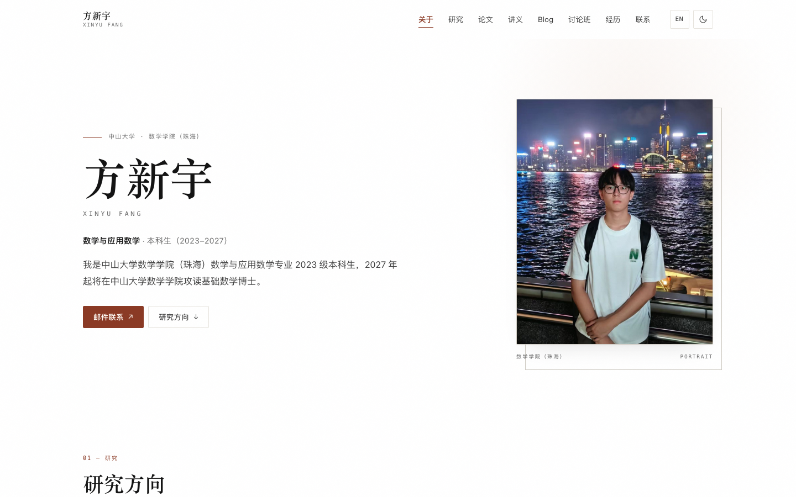

# 方新宇 · 个人学术主页

一个**单页、零依赖**的中英双语学术主页。以白色为主色调，另有深色模式；打开 `index.html` 即可使用，不需要安装、构建或联网。



## 页面结构

- **关于**：姓名、身份、教育背景、邮箱
- **研究方向**：双有理几何及其在模空间中的应用；对数论与算术几何的兴趣
- **论文发表**：预留模块，目前为空
- **讲义**：预留模块，目前为空
- **Blog**：预留模块，目前为空
- **讨论班**：2026 年春季代数几何讨论班
- **经历**：2027 级基础数学博士、2023–2027 本科
- **联系**：邮箱、工位、地址

导航栏包含全部八个入口；手机端收进折叠菜单。

## 本地查看

```bash
# 方式一：直接双击 index.html

# 方式二：本地服务器（推荐，行为与线上一致）
cd scholar-site
python3 -m http.server 8000
# 浏览器打开 http://localhost:8000
```

## 已包含

- 中 / English 一键切换，选择记在浏览器里
- 白色主色调 + 深色模式，默认跟随系统
- 桌面、平板、手机响应式；手机端折叠菜单
- 邮箱一键复制
- 打印样式：自动隐藏导航、头像、按钮，适合导出 PDF
- 全部图标与纹理为内联 SVG / CSS，无外部请求，可离线使用
- 语义化结构、键盘操作、`prefers-reduced-motion` 支持

## 修改指南

### 1. 姓名与邮箱

搜索 `方新宇`、`Xinyu Fang`、`fangxy56`：

- 首屏大标题、页头、页脚
- 3 个 `mailto:` 链接（首屏按钮、联系区块、页脚）
- 「复制邮箱」按钮的 `data-email` 属性

### 2. 照片

照片已经放在 `photo.jpg`，页面会按 4:5 自动裁切。换照片时直接替换 `photo.jpg`（保持文件名），或修改 `.portrait` 里的 ``。

建议竖版 4:5、宽度 800px 以上。照片下方的小字现在是 `数学学院（珠海） / PORTRAIT`，可以按需修改。

### 3. 研究方向

搜索 `主要研究方向是双有理几何`，直接改这一段的两句话即可；英文在相邻的 `data-en` 里。

### 4. 论文发表 / 讲义 / Blog

这三个模块目前各有一个占位块：

```html
<div class="module-empty reveal">
  <span class="empty-label" data-zh="内容整理中" data-en="Coming soon">内容整理中</span>
  <p data-zh="论文与预印本将在这里更新。" data-en="Papers and preprints will appear here.">论文与预印本将在这里更新。</p>
</div>
```

以后把整个 `module-empty` 替换成正文即可，例如论文列表、讲义 PDF 链接、Blog 文章列表。如果希望我按「论文条目 / 笔记卡片 / 文章列表」的样式排好，把内容发我即可。

### 5. 讨论班

搜索 `2026 春季`、`代数几何讨论班`，修改时间、名称和下面的单位。要加第二期讨论班时，复制整个 `.seminar` 区块即可。

### 6. 教育经历

搜索 `2027 —`、`2023 — 2027` 修改时间；搜索 `博士研究生（2027 级）`、`本科` 修改右侧标签。

如果已经正式入学，把首屏 bio 的「2027 年起将在中山大学数学学院攻读基础数学博士」改成「2027 年起在中山大学数学学院攻读基础数学博士」，并把首屏身份从「本科生」改为「博士研究生」。

### 7. 工位与地址

- 工位：`中山大学海琴二号`
- 地址：`广东省珠海市香洲区唐家湾镇大学路 2 号 中山大学珠海校区，519082`
- 说明：`工位暂定海琴二号，具体房间待定；欢迎邮件预约。`

等具体房间确定后，把工位改成「海琴二号 XXX 室」即可。

### 8. 标题与分享信息

修改 `<head>` 里的：

- `<title>`
- `<meta name="description">`
- `og:title` / `og:description`

### 9. 配色与字体

颜色集中在样式开头的 `:root` 与 `[data-theme="dark"]`：

| 变量 | 用途 |
| --- | --- |
| `--bg` / `--surface` | 页面底色 / 卡片底色（均为白色） |
| `--panel` | 空模块、说明框的浅灰底色 |
| `--ink` / `--body` / `--muted` | 标题 / 正文 / 次要文字 |
| `--accent` / `--accent-soft` | 强调色 / 浅强调底色 |

字体使用系统字体（`--serif` / `--sans`），离线、加载快；如需统一观感，可自行引入 Google Fonts。

### 10. 双语文字

每个可切换文本都有 `data-zh` 和 `data-en` 属性：

```html
<h2 data-zh="研究方向" data-en="Research">研究方向</h2>
```

新增内容时成对写好这两个属性，切换语言才不会中英混排。

## 部署

### GitHub Pages（免费）

1. 新建一个仓库，例如 `homepage`。
2. 上传 `index.html` 和 `photo.jpg`（`preview.png`、`README.md` 可选）。
3. 仓库 **Settings → Pages**，Source 选 **Deploy from a branch**，分支 `main`、目录 `/ (root)`，保存。
4. 一两分钟后访问 `https://你的用户名.github.io/homepage/`。

### Netlify Drop / Vercel

把整个 `scholar-site` 文件夹拖到 [Netlify Drop](https://app.netlify.com/drop)，或导入到 Vercel，框架选择 “Other / Static”，无需构建命令。

## 说明

- **论文发表、讲义、Blog 目前是空的**，只保留了模块和占位说明；等内容有了直接替换。
- 目前**没有放 CV 按钮**。把 PDF 放进本文件夹后，可在首屏按钮区加一个链接。
- 页面没有后端、没有 Cookie、没有第三方脚本；语言和主题偏好只存在浏览器 `localStorage`。
- 打印 / 导出 PDF 时会自动隐藏导航、头像和按钮，保留正文内容。
- 页面按 2026 年 11 月的时间写作：本科在读（2023–2027），2027 年起攻读博士；如状态有变化，按上面的说明调整。
